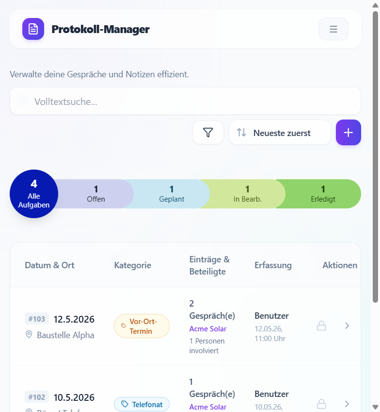

# Protokoll-Manager



Webanwendung zur Erfassung und Verwaltung von Gesprächs- und Besprechungsprotokollen.

Öffentliche **Portfolio-Version** mit fiktiven Demo-Daten (andere Zugangsdaten und `SECRET_KEY` als eine private Betriebsversion).

- Login mit Demo-Konten und Session-basierter Anmeldung
- Protokolle anlegen, bearbeiten und mit Einträgen, Aufgaben und Kommentaren führen
- Rollenmodell (Benutzer bis Master Developer) mit abgestuften Rechten
- Stammdaten und Benutzerverwaltung je nach Rolle

## Technik

| Teil | Technologie |
|------|-------------|
| Backend | Python 3.11+, Flask, SQLAlchemy, SQLite |
| Frontend | React 19, Vite, Tailwind CSS |
| Produktion | Waitress, statisches `frontend/dist` |

## Schnellstart (Entwicklung)

```powershell
# Backend
cd backend
python -m venv venv
.\venv\Scripts\activate
pip install -r requirements.txt
python app.py

# Frontend (zweites Terminal)
cd frontend
npm install
npm run dev
```

- Anwendung: http://localhost:5173  
- API: http://127.0.0.1:5000  

Demo-Login (nach `INSTALL.bat` oder `python seed.py`): z. B. `user` / `Demo2026!` (weitere: `mitarbeiter`, `admin`, `developer`, `master`)

## Produktion (Firmennetz, Firmen-PC als Host)

1. `INSTALL.bat` — installiert bei Bedarf Python und Node.js per **winget**, richtet venv ein, baut das Frontend  
2. `START.bat` — Anwendung auf dem **Host-PC** im Firmennetz  

Nur Frontend nachziehen (nach Code-Änderungen): `BUILD-FRONTEND.bat`  
Installation rückgängig: `DEINSTALL.bat` (Datenbank bleibt erhalten)

Details: **`EINRICHTUNG.md`**

## Dokumentation

Übersicht: **`docs/README.md`**

| Ordner / Datei | Inhalt |
|----------------|--------|
| `EINRICHTUNG.md` | Installation, Betrieb, Backup, Wiederherstellung |
| `docs/entwicklungsdoku/` | Entwicklung, Architektur, Codebeispiele |
| `docs/git-doku/` | Git-Workflow |
| `frontend/public/benutzerhandbuch/` | Endanwender-Handbuch (in der App) |
| `frontend/public/entwicklerdokumentation/` | Entwickler-Handbuch (Rolle Developer) |

## Skripte

| Datei | Funktion |
|-------|----------|
| `INSTALL.bat` | winget (Python/Node), venv, pip, ggf. seed, `npm install` + Build |
| `DEINSTALL.bat` | venv, `node_modules`, `dist` entfernen; DB bleibt |
| `BUILD-FRONTEND.bat` | nur `npm run build` |
| `START.bat` | Produktionsserver (Demo-`SECRET_KEY` für Sessions) |
